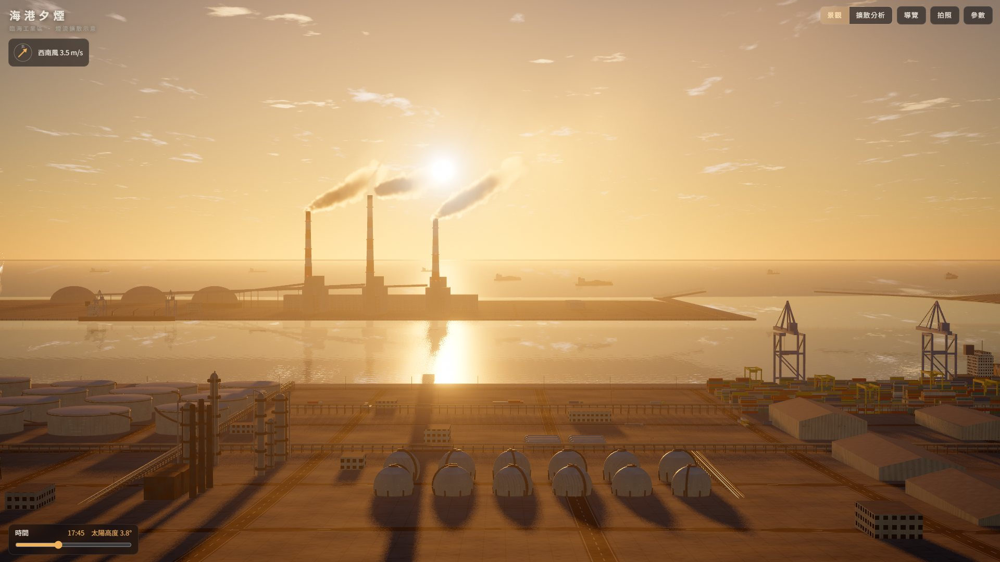
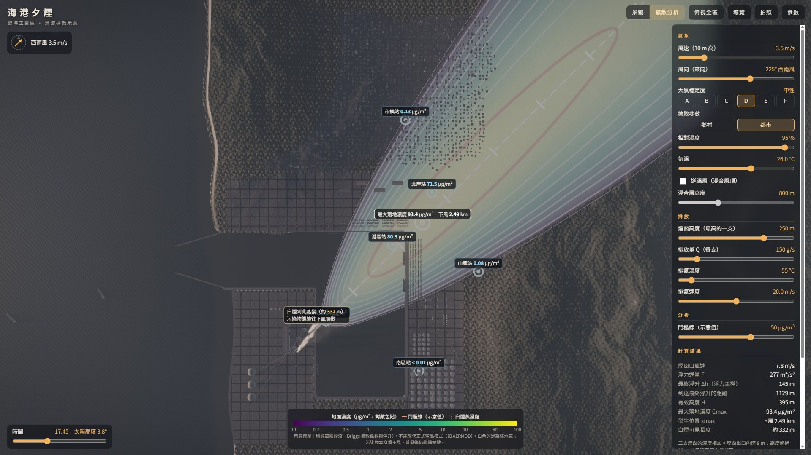

# 海港夕煙 Harbor Plume

用 WebGPU 在瀏覽器裡即時畫出黃昏的臨海工業港，畫面上的煙流和「擴散分析模式」的地面濃度圖，來自同一套高斯煙流模型。整個作品是一個 `index.html`，不用任何外部函式庫、圖片或 3D 模型。





## 解決什麼問題

煙道採樣量到的排放量、排氣溫度、出口流速，到了下風幾公里會變成多少地面濃度？正式的空品模式（例如 AERMOD）輸出的是表格和等值線圖，對客戶或一般民眾不直觀。

這個作品把同一套擴散模型同時做成兩種畫面：

- **3D 即時畫面**：煙流的寬度、高度和走向照模型計算，可以自由飛行、改時間看日落到夜晚。
- **分析模式**：地面濃度熱圖（μg/m³）、等值線、6 個虛構測站、最大落地濃度與位置。調整風速、穩定度、煙囪參數，畫面立刻跟著變。

## 怎麼開

需要支援 WebGPU 的瀏覽器：最新版的 Chrome 或 Edge，或 Safari 26 以上。建議用本機伺服器開啟：

```bash
python -m http.server 8765 --bind 127.0.0.1
```

然後打開 `http://127.0.0.1:8765/index.html`。

操作：點一下畫面後，滑鼠轉視角、W A S D 移動、Space／Shift 升降、滾輪調速度。手機用左下搖桿移動、拖曳畫面轉視角。

| 網址參數 | 作用 |
|---|---|
| `?selftest=1` | 跑物理與 GPU 自我測試，結果印在 console，並設定 `window.__selftest` |
| `?bench=1` | 20 秒固定路徑效能測試，結果在 `window.__bench` |
| `?shot=1`～`6` | 固定鏡頭（截圖用），準備好後印出 `SHOT_READY` |
| `?q=low`／`medium`／`high`／`ultra` | 指定畫質等級 |
| `?debug=1` | 在畫面上顯示錯誤和幀時間 |

## 怎麼做的

### 物理模型

- **高斯煙流模型**，含地面反射（鏡像源）。
- **擴散係數**：Briggs（1973）的 σy、σz，大氣穩定度 A–F，鄉村與都市兩組。
- **煙流浮升**：Briggs 公式，分浮力主導與動量主導、不穩定與穩定大氣，浮升過程照 2/3 次方律；含煙囪頂下洗修正。
- **風速剖面**：冪次律，把 10 m 風速換算到煙囪口高度。
- **混合層頂**：逆溫層存在時用多次反射；煙流衝破逆溫層時依 ISC3 慣例處理。
- **白煙與污染物分開**：白煙長度用混合線熱力學判斷水氣何時不再過飽和；污染物照高斯模型繼續擴散。
- 下風距離在 100 m 以內或 10 km 以外時，畫面會提示擴散係數屬外插。

### 畫面

- **WebGPU＋WGSL**：三十多個著色器模組，每個放在自己的 `<script type="text/wgsl">`。
- **大氣散射**：Hillaire（2020）的查表法（transmittance、multi-scattering、sky-view LUT）。
- **體積煙流**：沿視線逐步取樣（raymarching），密度＝模型算出的高斯外形 × 3D 雜訊；光照用光學深度體積、雙瓣相位函數，時間累積降噪。
- **地形與設施**：全部程序生成。clipmap 地形、instancing 的儲槽、管架、起重機、貨櫃與船；cascaded shadow maps。
- **水面**：方向性波浪、平面反射。
- **後製**：HDR、AgX 色調映射、bloom、MSAA 或 FXAA。
- **穩定性**：畫質分級、動態解析度、device lost 自動重建、切分頁暫停。

### 3D 畫面和分析模式共用同一套模型

JavaScript（雙精度）先算出每段下風距離的 σ 和浮升高度，存成查表交給 GPU 畫 3D 煙流。分析模式在 GPU 上用 WGSL（單精度）重寫一份濃度公式算 512×512 熱圖，再用自我測試比對兩邊的結果。

## 怎麼驗證

### 自我測試（`?selftest=1`，2026-11-17 執行：9/9 PASS）

| 項目 | 條件 | 計算值 | 參考值 | 結果 |
|---|---|---|---|---|
| a1 σy | D 級鄉村、x=1000 m | 76.277 m | 76.28 m | PASS |
| a2 σz | 同上 | 37.947 m | 37.95 m | PASS |
| a3 Briggs 最終浮升 | Ts=55 °C、Ta=26 °C、vs=20 m/s、d=8 m、250 m 煙囪 | 144.57 m | 144.58 m（手算） | PASS |
| b 地面中心線濃度 | Q=100 g/s、u=5 m/s、H=100 m | 68.287 μg/m³ | 68.29 μg/m³ | PASS |
| c 質量守恆 | 截面通量積分 | 100.000 g/s | 等於 Q | PASS |
| d 風速加倍 | 高度固定時的濃度比 | 0.5 | 0.5 | PASS |
| e1–e3 GPU 對 JS | 熱圖三個位置 | 相對誤差約 1e-5% | 1% 以內 | PASS |

### 效能（`?bench=1`，2026-11-17）

| 項目 | 結果 |
|---|---|
| 顯示卡 | NVIDIA GeForce GTX 1650（4 GB） |
| 解析度、畫質 | 1920×1080、high（MSAA 4×） |
| 平均幀時間 | 19.67 ms（約 50.9 fps） |
| p95 幀時間 | 23.7 ms |
| 主要 GPU 耗時 | 體積煙流 6.67 ms、主場景 6.32 ms、水面反射 0.91 ms |

目標是 high 畫質 1080p 平均 60 fps：**未達成（FAIL）**。瓶頸是體積煙流的 raymarching 和主場景。效能測試固定在 100% 解析度；一般使用時，動態解析度會在 GPU 一幀超過約 18.5 ms 時自動降解析度。

## 限制

- **示意模型，不能取代正式空品模式（如 AERMOD）**。畫面上的門檻線也標示為「示意值」。
- 沒有處理：地形起伏對擴散的影響、建築物下洗、污染物化學反應、隨時間變化的氣象。
- 場景是程序生成的意象，不是真實地圖，也沒有使用真實公司名稱或標誌。
- 只在一台電腦（GTX 1650）上實測過；手機版還沒有實機測試。
- 直接用 `file://` 開啟是否可行沒有測試過，建議用本機伺服器。

## AI 協助說明

| 部分 | 誰做的 |
|---|---|
| 需求、驗收標準、要驗證的物理性質 | 使用者（見 `PROMPT.md`） |
| 架構設計與全部程式碼、文件 | Claude（Anthropic）。M1–M7 由 Claude Fable 5.2 完成，之後的修正由 Claude Opus 5.5 完成，commit 訊息有標註 |
| 驗證 | 自動測試（selftest、bench）＋截圖檢查 |

設計說明見 `DESIGN.md`，開發過程與踩過的坑見 `PROGRESS.md`。

## 我做的

（留給作者填寫）

## 檔案

| 檔案 | 內容 |
|---|---|
| `index.html` | 作品本體（HTML、CSS、WGSL、JavaScript 全部在內） |
| `DESIGN.md` | 座標、物理模型、渲染流程、設計取捨 |
| `PROGRESS.md` | 里程碑、預設值、踩過的坑 |
| `PROMPT.md` | 原始需求 |
| `docs/` | README 用的截圖 |
